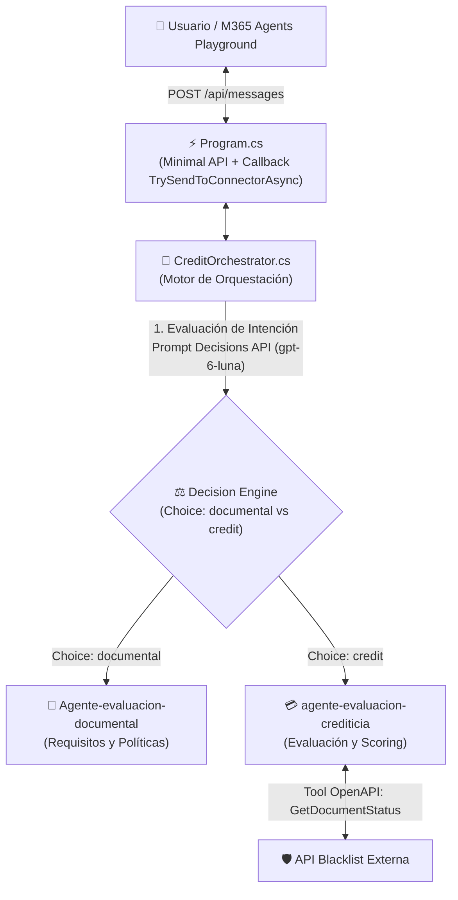

# AGNT Web App Orchestrator — Rama `feature/V1.1`

Proyecto para la orquestación conversacional de evaluación crediticia con **Azure AI Foundry**, dotado de un **Orquestador Inteligente basado en Prompt** siguiendo el estándar del **OpenAI Decisions API (`type: "choice"`)**, diseñado para integrarse con **Microsoft 365 Agents Playground** (`@microsoft/m365agentsplayground`) y Microsoft Teams.

---

## 🎯 ¿Qué novedades incluye la versión V1.1?

1. **Orquestador Cognitivo Basado en Prompt (Decisions API Pattern)**:
   - En lugar de reglas estáticas de Regex o enrutamiento ciego, el orquestador cuenta con un **Prompt de Decisión** formal basado en la especificación de OpenAI Decisions API (`POST /v1/decisions`, modelo `gpt-6-luna`).
   - El motor de decisión evalúa la consulta del usuario y selecciona la mejor opción (`choice`):
     - **`documental`** ➔ Si el usuario realiza preguntas informativas sobre requisitos, qué papeles o documentos se solicitan, políticas o condiciones previas.
     - **`credit`** ➔ Si el usuario solicita un crédito, proporciona su DNI, montos, cuotas o avanza en su evaluación financiera.
2. **Derivación Dinámica a Dos Agentes Especializados en Azure AI Foundry**:
   - `credit` ➔ Se deriva a **`agente-evaluacion-crediticia`** (scoring, cálculo de cuotas y validación en listas negras con tool OpenAPI).
   - `documental` ➔ Se deriva a **`Agente-evaluacion-documental`** (asesoría sobre documentos, comprobantes y políticas de crédito).
3. **Gestión de Memoria Aislada por Agente (`threadKey`)**:
   - Se mantiene el hilo conversacional nativo (`ProjectConversation`) particionado por agente (`{agentName}:{conversationKey}`), garantizando que el usuario pueda alternar entre dudas de requisitos y solicitudes de crédito en una misma sesión sin que los hilos colisionen en Azure AI Foundry.

---

## 🧩 Arquitectura de Enrutamiento Inteligente



---

## 📝 Especificación del Prompt de Decisión (OpenAI Decisions API)

El orquestador implementa el contrato de decisión:

```json
{
  "model": "gpt-6-luna",
  "input": "<mensaje del usuario>",
  "questions": [
    {
      "type": "choice",
      "name": "target_agent",
      "instructions": "Determina a qué agente especializado de Azure AI Foundry se debe derivar la consulta del usuario:",
      "choices": [
        {
          "value": "credit",
          "description": "Solicitudes de crédito, montos, cuotas, evaluación crediticia, DNI, capacidad de pago o temas financieros."
        },
        {
          "value": "documental",
          "description": "Consultas puramente informativas sobre requisitos documentales, qué papeles o documentos se solicitan, políticas de documentación o condiciones generales."
        }
      ]
    }
  ]
}
```

* **Respuesta Esperada del Decision Engine**:
  ```json
  {
    "answers": [
      {
        "type": "choice",
        "name": "target_agent",
        "choice": "credit",
        "confidence": 0.96
      }
    ]
  }
  ```

---

## 📁 Estructura del Código

```text
AGNT-webapp-orchestrator-simplificado/
├── Program.cs             # Minimal API: Endpoint /api/messages + Callback al conector M365 Playground
├── CreditOrchestrator.cs  # Orquestador con Prompt de Decisión (OpenAI Decisions API) y enrutador a Foundry
├── FoundryAgentClient.cs  # Cliente Azure AI Foundry (SDK Azure.AI.Projects, threads multi-agente y formateo JSON)
├── Constants.cs           # Textos constantes, plantillas de salida y respuestas mock
├── Models.cs              # Contratos Bot Framework Activity, DTO CreditEvaluationResult y modelos Decisions API
├── appsettings.json       # Configuración de endpoints, agentes y parámetros de Decisions API
├── appsettings.Development.json # Configuración local de contingencia (UseMock: true)
└── README.md              # Documentación técnica y guía de ejecución
```

---

## ⚙️ Configuración (`appsettings.json`)

```json
{
  "Logging": {
    "LogLevel": {
      "Default": "Information",
      "Microsoft.AspNetCore": "Warning"
    }
  },
  "AllowedHosts": "*",
  "Urls": "http://localhost:5000",

  "AzureAIFoundry": {
    "Endpoint": "https://azfoundry-poc001.services.ai.azure.com/api/projects/proy-agentes-poc",
    "UseMock": false,
    "Agents": {
      "Credit": "agente-evaluacion-crediticia",
      "General": "Agente-evaluacion-documental"
    }
  },

  "Decisions": {
    "Endpoint": "https://api.openai.com/v1/decisions",
    "Model": "gpt-6-luna",
    "ApiKey": ""
  }
}
```

---

## 🚀 Guía de Inicialización y Ejecución

### Prerrequisitos
- **.NET 8 SDK** instalado.
- **Node.js** (v18+) con `npx`.
- **Azure CLI** autenticado (`az login`).

---

### Paso 1: Autenticación en Azure CLI
```powershell
az login
```

---

### Paso 2: Iniciar el Orquestador Web (.NET 8)
En una terminal en la raíz del proyecto:
```powershell
dotnet run
```
*El servicio iniciará en `http://localhost:5000` con Swagger disponible en la raíz.*

---

### Paso 3: Iniciar Microsoft 365 Agents Playground
En una segunda terminal:
```powershell
npx @microsoft/m365agentsplayground -e http://localhost:5000/api/messages
```
Se abrirá automáticamente el navegador con la interfaz de chat emulando Microsoft Teams.

---

## 🧪 Pruebas de Enrutamiento Dinámico V1.1

### Caso 1: Consulta Informativa de Requisitos (Se deriva a Agente Documental)
* **Entrada**: `Hola, que requisitos y documentos piden para un credito?`
* **Decisión del Orquestador**: `Choice='documental'`
* **Agente Ejecutado**: `Agente-evaluacion-documental`
* **Respuesta**: Explica en detalle los requisitos de identidad, boletas de pago, estados de cuenta y comprobantes según el tipo de crédito.

---

### Caso 2: Solicitud de Evaluación Crediticia (Se deriva a Agente de Crédito)
* **Entrada**: `Hola, mi DNI es 12345678, solicito 10000 soles y tengo una bodega de abarrotes.`
* **Decisión del Orquestador**: `Choice='credit'`
* **Agente Ejecutado**: `agente-evaluacion-crediticia`
* **Respuesta**: Emite el veredicto aprobado, score 600, cuota mensual estimada y código de validación.

---

### Caso 3: Conversación Mixta en la Misma Sesión
El usuario puede preguntar primero por documentos y luego solicitar el crédito:
1. `¿Qué documentos piden?` ➔ El orquestador deriva a `Agente-evaluacion-documental`.
2. `Perfecto, evalúame con DNI 12345678 y 1000 soles` ➔ El orquestador detecta la intención crediticia y deriva a `agente-evaluacion-crediticia`, manteniendo ambos hilos activos.

---

## 📦 Ramas y Versionamiento
- **Repositorio Oficial**: [GitHub - Edinsondamian/AGNT-webapp-orchestrator](https://github.com/Edinsondamian/AGNT-webapp-orchestrator)
- **`feature/V1`**: Versión simplificada con canalización directa al agente de crédito sin lógica determinista de texto en C#.
- **`feature/V1.1` (Rama Actual)**: Versión con **Orquestador Cognitivo basado en Prompt (OpenAI Decisions API - `type: "choice"`)**, que evalúa la intención del usuario y deriva dinámicamente entre `Agente-evaluacion-documental` y `agente-evaluacion-crediticia`.
