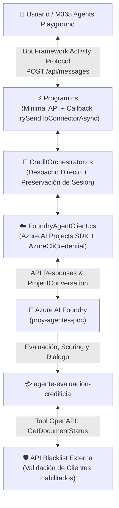

# AGNT Web App Orchestrator (Versión Simplificada)

Proyecto **ligero, desacoplado y sin sobre-ingeniería** para la orquestación conversacional de evaluación crediticia con **Azure AI Foundry**, diseñado para integrarse visualmente con **Microsoft 365 Agents Playground** (`@microsoft/m365agentsplayground`) y Microsoft Teams.

---

## 🎯 ¿Cómo funciona? (Resumen Ejecutivo)

1. **100% Conversacional — CERO Documentos Físicos**:
   - No se requieren boletas, recibos, fotos ni trámites en papel.
   - La captura de datos y la evaluación se realizan de manera fluida y conversacional en el chat.
2. **Datos Clave de la Evaluación**:
   - **Documento de Identidad (DNI)**: 8 dígitos numéricos.
   - **Monto Solicitado**: en Soles (PEN) o Dólares (USD).
   - **Actividad Económica / Negocio**: Rubro o fuente de ingresos (ej. bodega, transporte, restaurante, etc.).
3. **Arquitectura Agéntica Directa (Sin Regex ni Reglas Rígidas)**:
   - Se eliminaron las expresiones regulares y los parsers de texto deterministas en C#.
   - Los mensajes se canalizan directamente al agente cognitivo **`agente-evaluacion-crediticia`** en Azure AI Foundry, permitiendo que el modelo (`gpt-5.6-luna`) entienda lenguaje natural, intenciones mixtas, saludos, dudas de requisitos y evaluaciones crediticias de forma integral.
   - El agente valida en tiempo real con una herramienta OpenAPI de listas negras (`GetDocumentStatus`) y genera el scoring con cuotas estimadas.
4. **Memoria Multi-Turno Nativa Unificada**:
   - El orquestador mantiene el hilo de conversación (`ProjectConversation`) con Azure AI Foundry, asegurando que el contexto y los datos entregados por turnos se preserven sin fragmentación.

---

## 📁 Estructura del Código

```text
AGNT-webapp-orchestrator-simplificado/
├── Program.cs             # Minimal API: Endpoint /api/messages + Callback al conector M365 Playground
├── CreditOrchestrator.cs  # Orquestador: despacho directo y preservación de sesión con Azure AI Foundry
├── FoundryAgentClient.cs  # Cliente Azure AI Foundry (SDK Azure.AI.Projects, threads nativos y formateo JSON)
├── Constants.cs           # Textos constantes, plantillas de salida y respuestas mock
├── Models.cs              # Contratos Bot Framework Activity y modelos de transporte REST
├── appsettings.json       # Configuración del endpoint de Foundry y nombres de agentes
├── appsettings.Development.json # Configuración local de contingencia (UseMock: true)
└── README.md              # Documentación técnica y guía de ejecución
```

---

## 🧩 Componentes del Sistema



### 1. `Program.cs`
- **Minimal API en .NET 8**: Sin sobrecarga de controladores pesados ni capas innecesarias.
- **Evento de Bienvenida (`conversationUpdate`)**: Apenas el usuario ingresa al chat, recibe un saludo explicativo sobre el proceso 100% digital.
- **`POST /api/messages`**: Recibe las actividades del Bot Framework desde el playground.
- **`TrySendToConnectorAsync`**: Despacha la respuesta mediante HTTP POST directamente al conector local del Playground (`{serviceUrl}/v3/conversations/{convId}/activities`), permitiendo que la interfaz de Teams dibuje la burbuja de chat en tiempo real.

### 2. `CreditOrchestrator.cs` (100% Agéntico — Cero Regex)
- **Desacoplamiento Total**: Elimina el uso de expresiones regulares frágiles o listas de palabras clave para "adivinar" la intención del usuario.
- **Canalización Directa**: Valida entradas vacías y canaliza la conversación directamente al agente en Azure AI Foundry, preservando el identificador del hilo conversacional.
- **Ventajas de este diseño**:
  - **Cero Falsos Positivos**: Números de teléfono, montos o códigos postales ya no se confunden con DNIs mediante regex.
  - **Tolerancia a Faltas Ortográficas y Jergas**: El LLM entiende cualquier variación lingüística de forma natural.
  - **Memoria Unificada**: Todo el diálogo se mantiene en el mismo hilo (`ProjectConversation`), evitando que saltos entre agentes borren el contexto del usuario.

### 3. `FoundryAgentClient.cs`
- **Autenticación Segura con `AzureCliCredential`**: Se autentica utilizando las credenciales activas de Azure CLI (`az login`), sin llaves estáticas ni secretos quemados en el código.
- **Gestión de Hilos Multi-Turno (`ProjectConversationsClient`)**: Mantiene un diccionario en memoria (`ConcurrentDictionary<string, string>`) que enlaza el `conversationId` del chat con el hilo nativo de Azure AI Foundry.
- **Formateo Visual de Salida (`FormatAgentOutput`)**: Detecta cuando el agente en Foundry responde en formato JSON estructurado y lo convierte en una tarjeta legible para Teams con formato Markdown e íconos (`✅`, `⚠️`, cuota mensual y código de validación).
- **Modo Contingencia (`UseMock`)**: Permite alternar a simulación local para desarrollo desconectado.

### 4. `Models.cs`
- Define los registros de transporte del Bot Framework (`BotActivity`, `BotAccount`, `BotConversation`, `OutgoingActivity`) y los modelos REST (`ChatRequest`, `ChatResponse`).

---

## ⚙️ Configuración (`appsettings.json`)

```json
{
  "Logging": {
    "LogLevel": {
      "Default": "Information",
      "Microsoft.AspNetCore": "Warning"
    }
  },
  "AllowedHosts": "*",
  "Urls": "http://localhost:5000",

  "AzureAIFoundry": {
    "Endpoint": "https://azfoundry-poc001.services.ai.azure.com/api/projects/proy-agentes-poc",
    "UseMock": false,
    "Agents": {
      "Credit": "agente-evaluacion-crediticia",
      "General": "Agente-evaluacion-documental"
    }
  }
}
```

---

## 🚀 Guía de Inicialización y Ejecución

### Prerrequisitos
- **.NET 8 SDK** instalado.
- **Node.js** (v18+) con `npx`.
- **Azure CLI** instalado.

---

### Paso 1: Autenticación en Azure CLI
Inicia sesión con la cuenta autorizada en el proyecto de Azure AI Foundry:
```powershell
az login
```

---

### Paso 2: Iniciar el Orquestador Web (.NET 8)
En una terminal situada en la raíz del proyecto:
```powershell
dotnet run
```
*El servicio iniciará en `http://localhost:5000` y desplegará Swagger UI en la raíz.*

---

### Paso 3: Iniciar Microsoft 365 Agents Playground
En una segunda terminal:
```powershell
npx @microsoft/m365agentsplayground -e http://localhost:5000/api/messages
```
Se abrirá automáticamente el navegador con la interfaz de chat emulando Microsoft Teams.

---

## 🧪 Casos de Prueba y Respuestas Esperadas

A continuación se detallan los escenarios validados en vivo contra Azure AI Foundry:

### Caso 1: Bienvenida al Entrar al Chat
* **Evento**: El usuario abre la conversación en el Playground.
* **Respuesta del Bot**:
  > ¡Hola! 👋 Bienvenido al Asistente de Evaluación Crediticia en Microsoft 365 Agents Playground.  
  > Para evaluar tu crédito 100% digital (sin requerir documentos físicos ni papeleos), por favor indícame tu **número de DNI**, el **monto** que deseas solicitar y tu **actividad económica**.

---

### Caso 2: Saludo Conversacional y Chitchat
* **Entrada**: `Hola, buenas tardes`
* **Agente**: `agente-evaluacion-crediticia`
* **Respuesta Esperada**:
  > *¡Hola! Buenas tardes 😊 ¿Cómo estás? ¿En qué puedo ayudarte hoy?*

---

### Caso 3: Evaluación Completa — Cliente Habilitado (Aprobado)
* **Entrada**: `Hola, mi DNI es 12345678, requiero 10000 soles y tengo una bodega de abarrotes.`
* **Agente**: `agente-evaluacion-crediticia`
* **Comportamiento**: Invoca la herramienta OpenAPI de validación (DNI `12345678` retorna `isEnabled: true`), calcula el scoring de riesgo medio y dictamina.
* **Respuesta Esperada**:
  > ✅ **Evaluación Crediticia — Azure AI Foundry**  
  > • **Resultado**: APROBADO  
  > • **Score crediticio**: 600 (Riesgo: MEDIO)  
  > • **Monto aprobado**: S/ 10,000.00 PEN  
  > • **Cuota estimada**: S/ 931.14 / mes  
  > • **Validación**: VAL-20261105-000011  
  > • **Modalidad**: 100% digital sin requerir documentos físicos ni papeleos.

---

### Caso 4: Cliente en Lista Negra / No Habilitado
* **Entrada**: `Buenas noches, solicito un crédito de 15000 soles, mi DNI es 87654321 y trabajo en transporte de carga.`
* **Agente**: `agente-evaluacion-crediticia`
* **Comportamiento**: La herramienta OpenAPI detecta que el DNI `87654321` se encuentra inhabilitado (`isEnabled: false`).
* **Respuesta Esperada**:
  > *El cliente no está habilitado.*

---

### Caso 5: Conversación Multi-Turno (Memoria Contextual)
Demuestra que el orquestador y Azure AI Foundry conservan el contexto de la sesión sin pérdida de datos:

* **Turno 1 (Usuario)**: `hola, mi dni es 12345678`
* **Respuesta Turno 1 (Bot)**:
  > *El cliente está habilitado. Para continuar con la evaluación crediticia, indica el monto solicitado y la actividad del negocio.*
* **Turno 2 (Usuario)**: `quiero un monto de mil soles y soy comerciante`
* **Respuesta Turno 2 (Bot)**:
  > ✅ **Evaluación Crediticia — Azure AI Foundry**  
  > • **Resultado**: APROBADO  
  > • **Score crediticio**: 600 (Riesgo: MEDIO)  
  > • **Monto aprobado**: S/ 1,000.00 PEN  
  > • **Cuota estimada**: S/ 93.11 / mes  
  > • **Validación**: VAL-20261105-000012  
  > • **Modalidad**: 100% digital sin requerir documentos físicos ni papeleos.

---

## 📦 Repositorio y Versionamiento
- **Repositorio Oficial**: [GitHub - Edinsondamian/AGNT-webapp-orchestrator](https://github.com/Edinsondamian/AGNT-webapp-orchestrator)
- **Rama principal**: `main`
