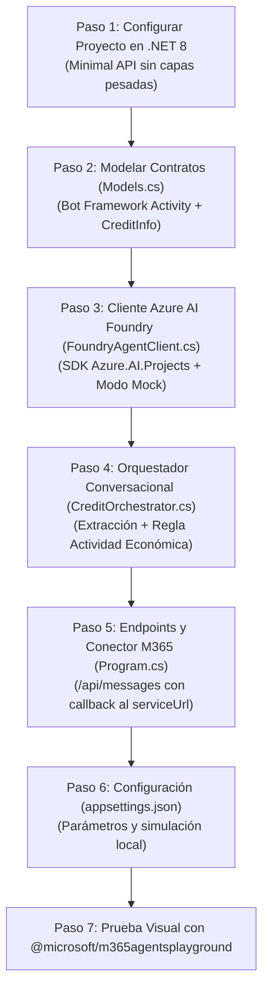

# AGNT Web App Orchestrator (Versión Simplificada)

Proyecto **super sencillo, funcional y sin sobre-ingeniería** para la orquestación conversacional de evaluación crediticia con **Azure AI Foundry**, diseñado para probarse visualmente en el playground oficial de Microsoft **`@microsoft/m365agentsplayground`**.

---

## 🎯 ¿Cómo funciona? (Resumen Ejecutivo)

1. **100% Conversacional — CERO Documentos**:
   - No se solicitan PDFs, fotos, boletas ni trámites físicos.
   - Toda la captura de datos se realiza a través del chat de Microsoft 365.
2. **Datos esenciales**:
   - **Número de DNI**: 8 dígitos numéricos.
   - **Monto**: en Soles (PEN).
   - **Actividad económica (OBLIGATORIA)**: Si el usuario omite su actividad o negocio, el bot la solicita de forma proactiva antes de evaluar.
   - **Plazo**: en meses (12 meses por defecto).
3. **Enrutamiento a Azure AI Foundry**:
   - Saludos o preguntas generales ➔ `Agente-consultas-generales`.
   - Solicitudes con datos completos ➔ `agente-evaluacion-crediticia` en Azure AI Foundry para scoring y dictamen.

---

## 📁 Estructura del Código (1 Solo Proyecto)

```text
AGNT-webapp-orchestrator-simplificado/
├── Program.cs             # Minimal API: Endpoints /api/messages y /api/chat + Callback a M365 Playground
├── CreditOrchestrator.cs  # Orquestador: extracción de datos, regla de actividad económica y enrutamiento
├── FoundryAgentClient.cs  # Cliente directo hacia Azure AI Foundry (con modo simulación Mock)
├── Models.cs              # Contratos Bot Framework Activity y modelos de negocio
├── appsettings.json       # Configuración de Azure AI Foundry y agentes
├── appsettings.Development.json # Configuración local (UseMock: true)
└── README.md              # Documentación y guía paso a paso
```

---

## 🛠️ Paso a Paso de la Creación del Código

Esta sección detalla cómo fue construido el proyecto desde una hoja en blanco hasta su integración final con Microsoft 365 Agents Playground.



---

### Paso 1: Configurar el Proyecto Minimal API (.NET 8)
Se creó un proyecto web ligero sin la sobrecarga de 6 capas ni dependencias de MediatR/CQRS.

* **Archivo**: `AGNT.WebappOrchestrator.csproj`
* **Target Framework**: `net8.0` (LTS instalada).
* **Paquetes NuGet instalados**:
  * `Azure.AI.Projects` (v2.1.0-beta.4): SDK oficial de Azure AI Foundry.
  * `Azure.Identity` (v1.21.0): Autenticación vía `DefaultAzureCredential`.
  * `Swashbuckle.AspNetCore` (v6.5.0): Documentación interactiva Swagger.

---

### Paso 2: Diseñar los Modelos y el Activity Protocol (`Models.cs`)
Microsoft 365 Agents Playground utiliza el **Bot Framework Activity Protocol**. Para comunicarse bidireccionalmente se crearon dos grupos de modelos:

1. **Modelos de Bot Framework / Teams**:
   * `BotActivity`: Representa el mensaje entrante del usuario (texto, remitente `From`, identificador de chat `Conversation`, y la URL de retorno `ServiceUrl`).
   * `OutgoingActivity`: El paquete completo que el playground necesita para renderizar la burbuja (incluye `From` con rol bot, `Recipient`, `ReplyToId` y `Timestamp`).
2. **Modelos de Negocio**:
   * `CreditInfo`: Guarda DNI, Monto, Actividad Económica y Plazo. Cuenta con la propiedad `HasRequiredData` que verifica si se tienen los 3 datos requeridos.
   * `ChatRequest` y `ChatResponse`: Para permitir pruebas directas por API REST (Swagger/Postman).

---

### Paso 3: Crear el Cliente de Azure AI Foundry (`FoundryAgentClient.cs`)
Permite invocar a los agentes configurados en Azure AI Foundry:

* **Modo Producción**: Utiliza `AIProjectClient` y `AgentsClient` para crear un hilo de conversación (`CreateThreadAsync`), enviar el mensaje y ejecutar el agente designado (`CreateRunAsync`).
* **Modo Simulación (`UseMock: true`)**: Permite ejecutar el sistema de forma 100% funcional localmente sin requerir credenciales ni saldo activo en Azure. Simula las respuestas del `Agente-consultas-generales` y del `agente-evaluacion-crediticia` calculando cuota mensual estimada y score crediticio en base a la actividad económica indicada.

---

### Paso 4: Implementar el Orquestador y Reglas de Negocio (`CreditOrchestrator.cs`)
El orquestador procesa el texto en lenguaje natural del usuario siguiendo 4 momentos clave:

1. **Extracción Conversacional (Cero Documentos)**:
   * Extrae el DNI buscando secuencias de 8 dígitos con Regex.
   * Extrae el monto identificando patrones monetarios (ej. `S/ 5,000`, `10000 soles`).
   * Detecta actividades económicas clave en el texto (comercio, bodega, transporte, restaurante, etc.).
2. **Validación de Consultas Generales**:
   * Si el usuario solo saluda ("hola", "buenas tardes") o hace preguntas generales, enruta al `Agente-consultas-generales`.
3. **Regla de Oro: Solicitar Actividad Económica**:
   * Si el usuario escribe DNI y monto pero **no indicó su actividad económica**, el orquestador no evalúa de inmediato, sino que responde solicitándola expresamente:
     > *"¡Hola! Para realizar tu evaluación crediticia sin requerir ningún documento físico ni papeleos, por favor indícame tu **actividad económica** o rubro de tu negocio (por ejemplo: bodega, transporte, comercio, restaurante, servicios, etc.)."*
4. **Enrutamiento y Evaluación**:
   * Cuando se cuenta con DNI, Monto y Actividad Económica, invoca al `agente-evaluacion-crediticia` en Foundry para generar la aprobación.

---

### Paso 5: Implementar los Endpoints y el Conector M365 (`Program.cs`)
En `Program.cs` se configuran los endpoints de la Minimal API:

1. **`POST /api/messages` (Para `@microsoft/m365agentsplayground`)**:
   * **Manejo de Bienvenida**: Detecta el evento `conversationUpdate` (cuando el usuario entra al chat) y envía un mensaje de bienvenida informando los requisitos.
   * **Manejo de Mensajes**: Procesa el texto con `CreditOrchestrator`.
   * **Envío al Connector del Playground (`TrySendToConnectorAsync`)**:
     * El Playground no lee la respuesta directamente del cuerpo HTTP, sino que espera un `POST` en su conector local:
       $$\text{POST } \texttt{\{ServiceUrl\}/v3/conversations/\{convId\}/activities}$$
     * La función `TrySendToConnectorAsync` despacha el `OutgoingActivity` hacia dicha URL para que la interfaz visual de Teams pinte la burbuja en tiempo real.
2. **`POST /api/chat` (Para Swagger y pruebas REST)**:
   * Endpoint simple que recibe `{ "message": "..." }` y retorna `{ "response": "...", "agent": "..." }`.

---

### Paso 6: Configuración del Sistema (`appsettings.json`)
Contiene la configuración de los agentes en Azure AI Foundry:

```json
{
  "AzureAIFoundry": {
    "Endpoint": "https://<tu-recurso>.services.ai.azure.com/api/projects/<tu-proyecto>",
    "UseMock": false,
    "Agents": {
      "Credit": "agente-evaluacion-crediticia",
      "General": "Agente-consultas-generales"
    }
  }
}
```

En `appsettings.Development.json` se encuentra `"UseMock": true` para desarrollo y presentaciones locales.

---

## 🚀 Cómo Ejecutar y Probar

### 1. Iniciar el Orquestador
En una terminal en esta carpeta:
```powershell
dotnet run
```
*La aplicación iniciará escuchando en `http://localhost:5000`.*

### 2. Abrir Microsoft 365 Agents Playground
En otra terminal:
```powershell
npx @microsoft/m365agentsplayground -e http://localhost:5000/api/messages
```

Se abrirá automáticamente la interfaz web en tu navegador.

---

## 💬 Guión de Demostración en el Chat

| Turno | Mensaje del Usuario | Respuesta del Asistente | Agente Invocado |
| :--- | :--- | :--- | :--- |
| **1. Saludo** | `Hola` | Saluda y explica que solo se necesita DNI, monto y actividad económica (cero documentos). | `Agente-consultas-generales` |
| **2. Datos incompletos** | `Mi DNI es 45892134 y quiero 15000 soles` | **Detecta la falta de actividad económica** y pide que se especifique el rubro del negocio o empleo. | `CreditOrchestrator` (Regla de Negocio) |
| **3. Completa actividad** | `Tengo un restaurante de comida criolla` | Retorna el dictamen de crédito con aprobación, cuota mensual estimada y score crediticio. | `agente-evaluacion-crediticia` |
